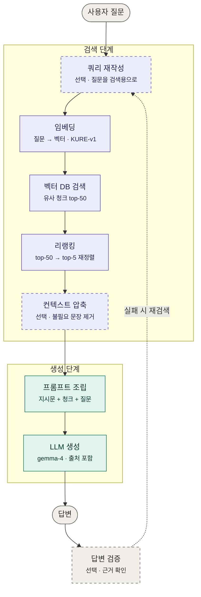

1. RAG 전체 구조

ㄱ) 검색 단계 (보라색)

a. 쿼리 재작성 (선택) — 사용자 질문이 검색에 안 좋은 형태일 때 LLM이 고쳐 쓴다. "그거 어떻게 해?"처럼 대명사가 많거나, 질문 하나에 여러 주제가 섞였을 때 효과가 크다. 처음엔 없어도 된다.

b. 임베딩 — 질문을 KURE-v1(또는 bge-m3)로 벡터로 바꾼다. 문서를 인덱싱할 때 썼던 것과 같은 모델이어야 한다.

c. 벡터 DB 검색 — 질문 벡터와 가까운 청크를 넓게 뽑는다. 여기서 top-50처럼 많이 뽑는 이유는 다음 단계인 리랭커가 걸러줄 걸 믿고 놓치는 것(recall)을 최소화하려는 것이다. 리랭커가 없으면 여기서 바로 top-5 정도만 뽑아 생성 단계로 넘긴다.

d. 리랭킹 — KURE-Reranker-nano 같은 cross-encoder가 (질문, 청크) 쌍 50개를 하나씩 정밀 채점해서 top-5로 압축한다. 벡터 검색에서 7위였던 정답 청크를 1위로 끌어올리는 게 이 단계의 역할이다.

e. 컨텍스트 압축 (선택) — 선별된 청크 안에서도 질문과 무관한 문장을 지워 토큰을 아낀다. 토큰 예산이 빠듯할 때만 고려한다.

ㄴ) 생성 단계 (청록색)

a. 프롬프트 조립 — [시스템 지시문] + [청크들 + 출처 ID] + [질문] 형태로 합친다. document_budget()이 여기서 청크를 몇 개까지 넣을지 결정하고, 넘치면 뒤쪽 청크를 잘라낸다.

b. LLM 생성 — gemma-4가 청크를 근거로 답을 쓴다. "청크에 없는 내용은 모른다고 해라", "답변 끝에 참고한 청크 ID를 적어라" 같은 지시가 프롬프트에 들어간다.

c. 답변 검증 (선택) — 생성된 답이 청크에 근거하는지, 질문에 실제로 답했는지 LLM이나 규칙으로 확인하고, 실패하면 쿼리를 바꿔 검색 단계로 되돌린다. Self-RAG, CRAG 같은 이름으로 불리는 패턴들이 여기 해당한다.

ㄷ) 경계 기억법

LLM이 답변 문장을 쓰기 시작하기 전까지는 전부 검색, 그 이후는 생성이다. 리랭킹·압축이 검색 쪽인 이유가 이거고, 디버깅할 때도 "청크에 정답이 있나?"(검색 문제)와 "청크엔 있는데 답이 틀렸나?"(생성 문제)를 먼저 가르면 어디를 고칠지 바로 보인다.

2. 2step RAG

ㄱ) 검색 (Retrieval)
    - 질문에 답하는 데 필요한 근거 자료를 찾아오는 단계

    질문 → 임베딩(bge-m3) → 벡터 DB에서 유사 청크 top-k 검색 → 청크 목록 + 출처

    - 입력: 사용자 질문
    - 출력: 관련 청크 몇 개 (텍스트 + 메타데이터)
    - 핵심 결정: 청크 크기, k 값, 유사도 기준, 하이브리드 여부

ㄴ) 생성 (Generation)
    - 찾아온 자료를 근거로 LLM이 답을 쓰는 단계

    질문 + 검색된 청크 → 프롬프트 조립 → LLM(gemma4:12b) → 답변

    - 입력: 질문 + Step 1의 청크들
    - 출력: 자연어 답변 (보통 출처 표기 포함)
    - 핵심 결정: 프롬프트 설계, 토큰 예산 배분, 출처 인용 방식, 근거 없을 때 처리

ㄷ) 2step으로 구분하는 이유
    - 두 단계는 실패 양상이 완전히 다르고, 따로 평가·개선해야 하기 때문이다.

| 증상 | 어느 단계 문제? | 고치는 방법 |
|---|---|---|
| 답에 필요한 내용이 청크에 아예 없음 | Step 1 (검색) | 청크 크기·k 조정, 임베딩 모델 교체, 하이브리드 검색, 리랭킹 추가 |
| 청크엔 정답이 있는데 LLM이 엉뚱하게 답함 | Step 2 (생성) | 프롬프트 수정, 모델 교체, 청크 순서 조정 |
| 청크에 없는 내용을 지어냄 | Step 2 (생성) | "근거 없으면 모른다고 해" 지시 강화 |
| 답은 맞는데 출처가 틀림 | Step 2 (생성) | 출처 포맷 명시, 청크에 ID 부여 |
